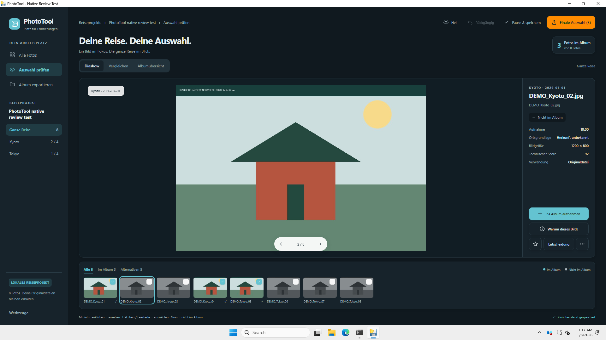

# PhotoTool – Photobook Curator

Lokales Windows-Programm und CLI: grosse Urlaubssammlungen für ein Fotobuch
reduzieren, prüfen und als geordnete Originalkopien exportieren. Das endgültige
Drucklayout entsteht anschliessend in deiner Fotobuchsoftware. PhotoTool eignet
sich für beliebige Reisen.

**Bedienung:** [Reiseprojekte und Fotoansicht](REISEPROJEKTE.md) ·
[Japan-Workflow für 2.000+ Fotos](JAPAN_WORKFLOW.md) ·
[Technischer Check und Prüfgrenzen](TECHNIK_CHECK.md).

## Neu in 0.5.1: Vorschau bleibt im Fenster

Lange Kapitel- und Transitlisten haben in 0.5.0 die gesamte Fotoansicht vergrössert.
Jetzt scrollt die Kapitelliste unabhängig; Diashow, Vergleich und Albumübersicht
halten Fotos und Bedienelemente innerhalb des Fensters. Die Startseite ist
übersichtlicher und verwendet dasselbe neue Programmlogo wie Fotoansicht,
Fenstersymbol und Installer.

**Keine neue Foto-/KI-Analyse nötig:** vorhandenes Reiseprojekt fortsetzen.
Bei unbelegten oder widersprüchlichen Ortsangaben öffnet **Zuordnung prüfen**
die bestehende GPS-/Zeitprüfung mit Änderungsvorschau. Eine Motivbeschreibung
ist kein Ortsnachweis; Orte ohne ausreichende Grundlage können ungeklärt bleiben.

## Deine Reise. Deine Auswahl.

Die freigegebene HTML-Oberfläche ist jetzt die Fotoansicht mit echten
Projektbildern und gespeicherten Entscheidungen. Dunkle und helle Darstellung,
Kapitel links und drei Ansichten halten denselben Bearbeitungsstand zusammen:

- **Diashow:** grosse Vorschau und gemischter Filmstreifen mit allen Bildern.
- **Vergleichen:** Albumfoto und Alternative direkt vergleichen; getrennte
  Bildleisten für Album und Alternativen. Hinzufügen und Ersetzen sind eigene Aktionen.
- **Albumübersicht:** die Sammlung als durchblätterbares Raster prüfen.

Ein Miniaturklick zeigt ein Bild an. Erst **Häkchen / Leertaste** ändert die
Auswahl. Nicht ausgewählte Miniaturen sind grau; ausgewählte sind farbig mit
Häkchen. Die grosse Vorschau bleibt farbig. Grau bedeutet „nicht im Album“,
keine Löschung. Aufgenommene Alternativen bleiben zum Vergleichen sichtbar.

**Warum dieses Bild?** zeigt aufgezeichnete Auswahlgründe, manuelle Vorgaben und
Ortsnachweise. **Werkzeuge** bietet Prüfbericht, Ortsprüfung, Quellenzuordnung und
Zugang zu den vorhandenen erweiterten Prüfwerkzeugen. Alte Auswahlen ohne
Entscheidungsprotokoll erhalten keine erfundenen nachträglichen Gründe.

**Finale Auswahl** exportiert wahlweise alle ausgewählten Bilder gemeinsam in
`selected/` oder nach Kapiteln. Es werden nur Kopien der definitiven Auswahl
exportiert; die Originaldateien bleiben unverändert. Bestehende Reiseprojekte,
Favoriten und dauerhafte Bildentscheidungen werden weiterverwendet.

Echte Windows-Aufnahme mit erzeugten Testmotiven:



[Vergleich](docs/screenshots/phototool-0.5.0-review-b-windows-test.png) ·
[Albumübersicht](docs/screenshots/phototool-0.5.0-review-c-windows-test.png)

## Windows-Programm und Updates

Veröffentlichte Installer `PhotoTool-Setup-<Version>.exe` und portable ZIPs stehen
unter [Releases](https://github.com/Dobolino/PhotoTool/releases). Der Installer
richtet PhotoTool im Benutzerprofil mit Startmenü und Deinstallation ein. Eine
eigene Python-Installation ist nicht nötig. Ein Quellcheckout lässt sich weiterhin
über `Fotobuch starten.bat` starten; siehe [ANLEITUNG.md](ANLEITUNG.md).

Die Fotoansicht läuft unter Windows in einem eigenen Programmfenster mit
Microsoft Edge WebView2. Der Installer prüft diese kostenlose Laufzeit und
installiert sie bei Bedarf über Microsofts offiziellen Bootstrapper; dafür ist
Internet nötig. Das portable ZIP benötigt eine bereits vorhandene WebView2-Laufzeit.
Die HTML-Dateien sind lokal gebündelt, Fotos und Entscheidungen werden nur über
einen sitzungsgebundenen Dienst auf `127.0.0.1` bereitgestellt. Es gibt dafür
keinen gehosteten Webdienst und keine Fotoübertragung ins Internet.

**Updates** prüft auf neue stabile Releases. Download und Installation starten
nach Bestätigung; Grösse und SHA256 werden geprüft. Während einer Analyse wird
keine Installation gestartet. Offene Review-Entwürfe werden vor dem Update
gesichert; scheitert die Sicherung, wird die Installation blockiert.
In Python-Entwicklungsstarts öffnet die Schaltfläche die Release-Seite.

## Prüfen und fortsetzen

- **Favoriten schützen:** geschützte Bilder erst nach Aufheben des Schutzes
  entfernen oder ersetzen. Schutz und dauerhafte Behalten-/Ausschliessen-
  Entscheidungen bleiben im Projekt erhalten; sie können automatische Caps übersteuern.
- **Rückgängig / Wiederholen:** Änderungen innerhalb der Sitzung zurücknehmen.
  Der Entwurf speichert den aktuellen Zustand, keine sitzungsübergreifende Undo-Historie.
- **Pause & speichern:** Entscheidungen, aktuelle Ansicht, Kapitel und Vorschau
  sichern und schliessen. Änderungen werden zusätzlich automatisch gespeichert.
  Ein Speicherfehler wird angezeigt und verhindert das reguläre Schliessen.
- **Prüfbericht:** aktuelle manuelle Vorgaben und letzte aufgezeichnete automatische
  Entscheidungen getrennt prüfen. HTML/CSV sind offline lesbar.
- **Orte neu prüfen:** Änderungsvorschau vor dem Speichern, ohne neue KI oder
  Neuauswahl. Offline-Orte sind eine Näherung an einen kleinen Städtekatalog bis
  25 km, keine Stadtteilerkennung. Optional liefert Nominatim Online-Ortsnamen.
- **Weitere Werkzeuge:** Druckqualität, Motivgruppen, Erzählmix und Kapitelplanung
  bleiben über **Werkzeuge** erreichbar; bei Bedarf öffnet sich die vorhandene
  native Prüfoberfläche mit dem aktuellen Projektstand.

Vorschauen benötigen die Originaldateien weiterhin an erreichbaren Pfaden.
Verschobene Quellen lassen sich über **Originale wiederfinden** neu verknüpfen.

## Entwicklungsinstallation

Python 3.11+ wird nur für einen Start aus dem Quellcode benötigt:

```bash
python -m venv .venv
source .venv/bin/activate
pip install -r requirements.txt
```

Die lokale Auswahl benötigt keinen KI-Anbieter. Optional sind Gemini
(`GEMINI_API_KEY`), Anthropic (`ANTHROPIC_API_KEY`) oder ein lokales
[Ollama](https://ollama.com) mit Vision-Modell nutzbar. Online-Geocoding, externe
KI, Updates und anfängliche Modell-/Laufzeitdownloads benötigen Netzwerk;
die gebündelte Fotooberfläche selbst benötigt keinen externen Server.

## Schnellstart über CLI

```bash
python scripts/create_sample_dataset.py

# Lokal, ohne Online-Geocoding oder Gesichtsanalyse
python -m photobook_curator -i sample_photos -o output_sample \
  -n 20 --no-geocode --no-faces --no-content-clusters

# Finale Auswahl gemeinsam statt in Kapitel-Unterordnern exportieren
python -m photobook_curator -i sample_photos -o output_flat \
  -n 20 --export-layout flat --no-geocode --no-faces --no-content-clusters

# Optional nur KI-Kosten/Kandidaten schätzen; erzeugt keine fertige KI-Auswahl
python -m photobook_curator -i sample_photos -o output_sample -n 20 \
  --ai-review --ai-provider anthropic --dry-run --no-geocode
```

## Wichtige CLI-Parameter

| Parameter | Beschreibung | Standard |
|-----------|--------------|----------|
| `-i/--input` | Eingabeordner | Pflicht |
| `-o/--output` | Projekt-/Ausgabeordner | Pflicht |
| `-n/--target-count` | Zielanzahl Bilder | 80 |
| `--export-layout` | `chapters` oder `flat` | chapters |
| `-k/--candidate-factor` | Kandidatenfaktor | 4 |
| `--geocode` / `--no-geocode` | Nominatim Reverse Geocoding | an |
| `--ai-review` | KI an (ohne Provider → Gemini) | aus |
| `--ai-provider` | `none` / `gemini` / `anthropic` / `ollama` | none |
| `--ai-model` | Optionales Modell | Provider-Default |
| `--dry-run` | Nur Kostenschätzung / Kandidaten zählen | aus |
| `--max-per-day` | Harte albumweite Tagesgrenze; `0` ohne Grenze | 0 |
| `--max-per-chapter` | Kapitelgrenze einschliesslich Essen; `0` ohne Grenze | 0 |
| `--food-ratio` | Max. Essens-Anteil pro Region | 0.15 |
| `--similarity-threshold` | Diversitätsfilter | 0.92 |

## Dateien und Pipeline

- `phototool_project.json` – Reise, Quellen und Einstellungen, ohne API-Schlüssel.
- `photos_analysis.csv` – Metadaten, Scores, Auswahl, Kennzeichnungen und Protokolle.
- `selection_draft.json` – fortsetzbarer Bearbeitungsstand und manuelle Entscheidungen.
- `analysis_cache.sqlite` – wiederverwendbare lokale Analysemerkmale.
- `selected/` – nur ausgewählte Originalkopien: gemeinsam als `001_Dateiname.ext`
  oder in Kapitelordnern wie `01_Region/hauptteil` und `01_Region/essen`.
- `selection_audit.html` / `.csv` – Prüfbericht; `inhaltsverzeichnis.md` – Kapitelübersicht.
- `geocode_cache.json` – lokaler Nominatim-Cache, falls genutzt.

Ablauf: Import/EXIF → lokale Qualität, Duplikate und Serien → Orte/Kapitel/Transit →
Kandidaten und optionale KI → Reduktion mit Verteilung und Caps → Prüfen → Export.
Ein separat aktivierter Dokumentpool gehört nicht automatisch zur finalen Album-Auswahl.
