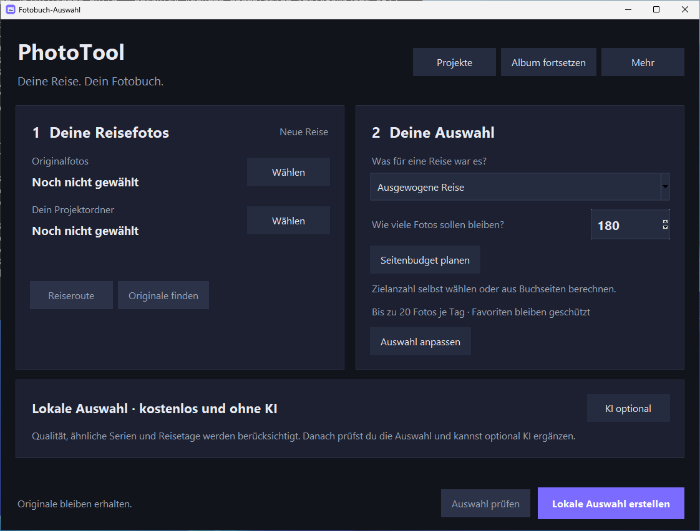
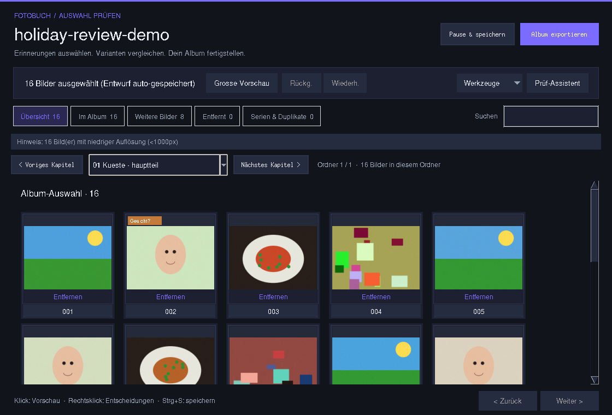
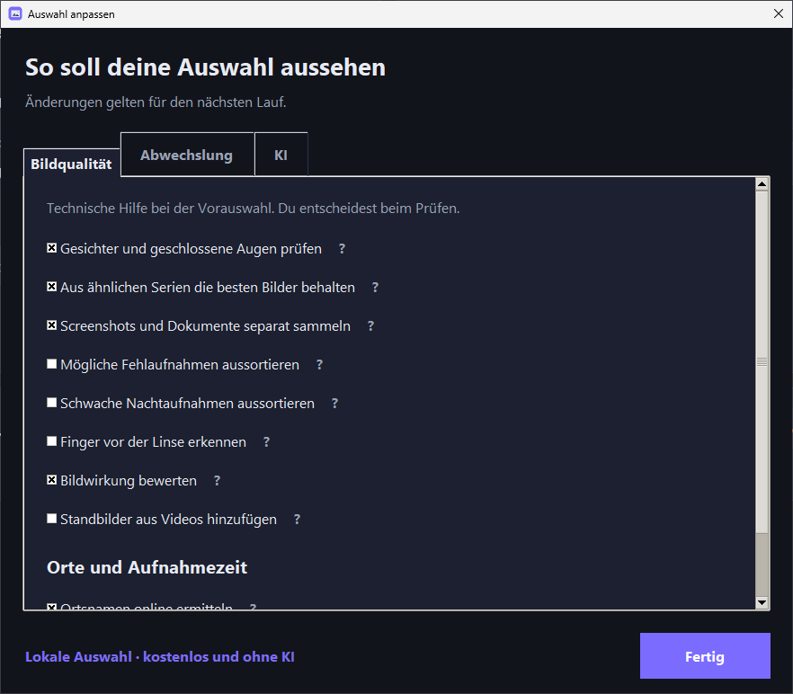
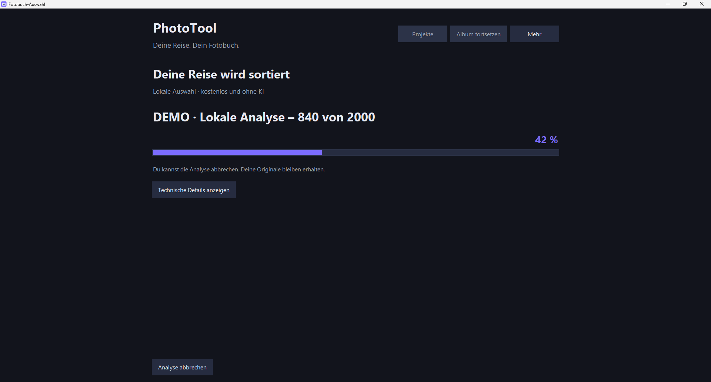

# PhotoTool 0.4.1: Jede Reise, ein eigenes Album

PhotoTool reduziert eine Fotosammlung für ein Fotobuch. Das endgültige Layout
entsteht anschliessend in deiner Fotobuchsoftware. Alle Funktionen sind für
beliebige Reisen gedacht, nicht speziell für Japan.

Die folgenden Ansichten wurden in der laufenden Windows-App aufgenommen.
[Maximierte Ansicht bei 1920 × 1080](docs/screenshots/phototool-0.4.1-windows-maximized.png).

## Der Ablauf

1. **Reise importieren:** Über **Projekte** eine Reise mit Namen, Originalordner
   und eigenem Projekt-/Ausgabeordner anlegen. Eine bestehende Reise über die
   zuletzt verwendeten Projekte oder ihre Projektdatei öffnen.
2. **Album planen:** Reiseprofil wählen, Zielanzahl direkt eingeben oder aus
   Buchseiten, reservierten Seiten und durchschnittlichen Fotos pro Seite
   berechnen lassen. Beispiel: 80 Seiten, davon 4 für Titel/Text, bei 2,5 Fotos
   pro Bildseite ergeben 190 Zielbilder. Das ist ein Auswahlbudget, kein Layout.
3. **Analysieren:** Die lokale Analyse bewertet Qualität, ähnliche Bilder,
   Serien und Orte. Tages-/Kapitelgrenzen und die optionale Erzählbalance
   berücksichtigen die gewünschte Verteilung.
4. **Prüfen:** Album, Kandidaten, entfernte Bilder und Serien durchsuchen.
   Der Prüf-Assistent zeigt zuerst auffällige Auswahlkonflikte, vergleichbare
   Motivgruppen sowie die Bildmischung der Kapitel.
5. **Exportieren:** Ausgewählte Originaldateien werden in Kapitelordner kopiert.
   Zwischenstände lassen sich jederzeit sichern und später fortsetzen.

## Lokal auswählen oder mit KI ergänzen

**Lokale Auswahl erstellen** liefert bereits eine vollständige Auswahl ohne
KI-Anbieter. Bildqualität, Duplikate, Serien, Tage und Kapitel werden berücksichtigt.
Danach kannst du die Auswahl prüfen, verändern und exportieren.

KI ist eine optionale zusätzliche Bewertung. Unter **KI optional** kannst du
später einen Anbieter wählen und einen weiteren Lauf starten; vorhandene lokale
Analysewerte werden soweit möglich wiederverwendet. Innerhalb eines KI-Laufs ist
die Reihenfolge: lokale Analyse → Kandidaten → KI-Bewertung → endgültige Auswahl.
Es werden nicht automatisch alle Originalbilder an einen Anbieter geschickt.

**Nur Kosten schätzen** liefert keine fertige Auswahl und startet keine
KI-Bewertung. Der Modus, Anbieter und die abweichende Startaktion werden deshalb
vor dem Start deutlich angezeigt. Kostenpflichtige Anbieter benötigen einen
Zugangsschlüssel; er wird nicht in der Projektdatei gespeichert.

## Einstellungen und Fortschritt

**Auswahl anpassen** öffnet drei kompakte Bereiche: **Bildqualität**,
**Abwechslung** und **KI**. Die Hauptansicht wird dadurch nicht zu einem langen
technischen Formular. Das Seitenbudget findest du auch unter **Seitenbudget planen**.
Änderungen gelten für den nächsten Analyselauf. Kurze Erklärungen erscheinen direkt
an der jeweiligen Fragezeichen-Schaltfläche; Escape oder ein Klick daneben schliesst sie.

Nach dem Start zeigt eine eigene Ansicht die aktuelle Aufgabe und den Fortschritt.
**Technische Details anzeigen** öffnet bei Bedarf das Protokoll. Nach Abschluss,
Abbruch oder Fehler ist die Planung wieder erreichbar.

## Reiseprofile

- **Ausgewogene Reise:** flexibler Start mit Tagesabdeckung.
- **Städtereise:** abwechslungsreiche Szenen statt vieler ähnlicher Varianten.
- **Strand / Natur:** zurückhaltende Szenen-/Personengewichtung; kein erzwungener
  Menschenanteil, wenn eine Reise vor allem Landschaften enthält.
- **Rundreise:** Aufmerksamkeit für unterschiedliche Tage und Reiseabschnitte.
- **Eigene Einstellungen:** Werte individuell anpassen.

Profile sind Startwerte. Tagesgrenzen, Kapitelgrenzen, Erzählbalance und weitere
Optionen bleiben pro Projekt veränderbar. Das Anwenden eines Profils verändert
Einstellungen, aber startet nicht von selbst eine Analyse und schreibt keine
Bildentscheidungen um.

## Entscheidungen, die bleiben

Die aktuelle Album-Auswahl und eine dauerhafte Entscheidung sind verschieden:

- **Dauerhaft behalten:** auch bei einer neuen Analyse oder Auswahl berücksichtigen.
- **Dauerhaft ausschliessen:** bei Neuberechnung nicht wieder automatisch aufnehmen.
- **Automatik:** die dauerhafte Vorgabe aufheben und neu bewerten lassen.

Eine eigene Begründung kann gespeichert werden. Favoritenschutz hat Vorrang,
auch gegenüber einer gespeicherten Ablehnung; diesen Schutz zuerst entfernen,
wenn das Bild wirklich ausgeschlossen werden soll. Geschützte oder dauerhaft
behaltene Bilder können Zielzahl und automatische Caps überschreiten.

Im Review öffnen **K / X / U** die entsprechenden Behalten-/Ausschliessen-/Automatik-
Aktionen für das aktuelle Bild. Innerhalb von Eingabefeldern bleiben normale
Texteingaben erhalten. **Strg+Z / Strg+Y** machen Änderungen innerhalb der Sitzung
rückgängig bzw. wiederholen sie.

## Bewusster vergleichen

**Zuerst prüfen** priorisiert unter anderem Qualitätsprobleme, Konflikte zwischen
Bewertung und Auswahl sowie nahe Alternativen. Es zeigt nachvollziehbare Hinweise,
keine mathematisch kalibrierte Wahrscheinlichkeit einer „richtigen“ Entscheidung.

**Motivgruppen** nutzen vorhandene Serien, Inhaltscluster, pHash und Szenenlabels.
Die Gruppen sind Vergleichsvorschläge. „Beste 1–2 übernehmen“ ist eine bewusste
Benutzeraktion; Favoriten und dauerhaft behaltene Bilder bleiben geschützt.
Eine Szene wie „Tempel“ wird nicht neu semantisch erkannt.

**Erzählmix** zeigt Übersicht, Menschen, Details und Atmosphäre je Kapitel. Die
Zuordnung beruht auf vorhandenen Szenen-/Gesichtsmerkmalen. Eine optionale
Erzählbalance unterstützt diese Mischung bei der Auswahl; eine ruhige Naturreise
muss nicht alle Kategorien abdecken.

## Verschobene Originale wiederfinden

**Originale wiederfinden** öffnet eine Vorschau der Pfadzuordnung:

1. Bisherigen gemeinsamen Originalordner angeben.
2. Neuen gemeinsamen Originalordner wählen.
3. Die Zuordnung prüfen und erst dann übernehmen.

Die relative Ordnerstruktur muss erhalten sein. Fehlende oder mehrdeutige Ziele
werden nicht geraten. CSV und Entwurf werden gemeinsam mit Wiederherstellungs-
protokoll aktualisiert; Originale werden weder verändert noch neu analysiert.
Bei einem gespeicherten Reiseprojekt wird auch dessen Originalordner aktualisiert,
damit spätere Analyseläufe dieselben Quellen verwenden. Eine unvollständige
Quellkopie wird nicht als neuer gemeinsamer Stammordner übernommen.

## Dateien und Updates

`phototool_project.json` beschreibt Reise, Quellen und Einstellungen.
`selection_draft.json` bleibt der Bearbeitungsstand mit Bildentscheidungen.
`photos_analysis.csv` enthält Analyse und exportierbare Metadaten;
`analysis_cache.sqlite` beschleunigt weitere Läufe. API-Schlüssel werden nicht in
Projektdateien gespeichert.

Das Repository ist öffentlich. Stabile Windows-Installer und portable ZIPs werden
über GitHub Releases verteilt. **Mehr → Updates** prüft auf eine neuere stabile Version;
Downloads werden anhand Grösse und SHA256 geprüft. Vor der Installation werden
Review-Entwürfe gesichert. Scheitert die Sicherung, wird die Installation blockiert.
